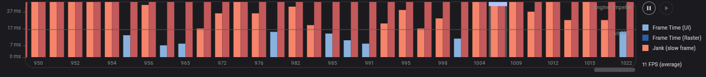
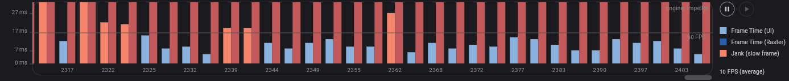

# Solutions — Rescu Assessment

## Part C — Written Deliverables

### RES-101 · Search shows results for the wrong query

#### Root Cause
Two interacting issues caused the bug:
1. **Asynchronous Race Condition (Out-of-Order Resolution):** In `SearchDealsController`, `onQueryChanged(query)` triggered `_search(query)` immediately on every keystroke. 5 concurrent asynchronous requests are dispatched; `"sushi"` finishes first and updates the UI, but moments later the older, slower requests for `"s"` and `"su"` resolve and overwrite `results` with stale data.
2. **Lack of Debouncing:** Every single keystroke immediately fired an HTTP request, flooding the simulated backend and amplifying the out-of-order execution.

#### Why This Fix Is the Right One
- **Request Versioning:** Every search invocation captures an incremented `_searchVersion`. This ensures that only the response matching the latest query can update `results` or dismiss `isLoading`.
- **Debouncing:** Pauses 300ms after the last keystroke before firing an API call

#### Alternatives Considered & Rejected
1. **"Debounce Only" (Rejected):**
   - *Why rejected:* Debouncing only spaces out request *dispatch*; it does not eliminate network race conditions.
2. **HTTP `CancelToken` / Backend Request Abort (Rejected):**
   - *Why rejected:* `FakeApiService` simulates a backend API without cancellation support, and ground rules prohibit modifying `FakeApiService`. Discarding stale responses at the controller boundary is the correct architectural pattern.

#### Edge Cases Considered
- **Rapid text clearing (Backspace / Clear):** Handled. When `trimmed.isEmpty`, `_debounceTimer` is cancelled immediately, `_searchVersion` is bumped to invalidate any in-flight response, and `results` / `hasSearched` are reset instantly.
- **Controller teardown mid-flight (`onClose`):** Handled. `_debounceTimer?.cancel()` runs on controller disposal to prevent post-dispose callbacks.
- **Loading state desynchronization:** Handled. `isLoading.value = false` only executes if `version == _searchVersion` in the `finally` block, ensuring the spinner does not disappear prematurely while a newer request is still in-flight.
- **Errors from outdated queries:** Handled. Stale requests that fail do not log errors or trigger error snackbars.
- **Redundant whitespace changes:** Handled. Strings are trimmed before evaluation so trailing spaces do not trigger new network requests.
- **Offline / automatic retry (Decided not to handle):** Search-as-you-type should not automatically retry stale queries on failure, as doing so would cause ghost queries when connectivity recovers. Users naturally retry by typing.

### RES-102 · Crash after leaving My orders

#### Root Cause
`PickupCountdown` started a periodic timer in `initState()`, but didn’t keep a reference to the timer or cancel it when the widget was removed. After leaving My orders, the timer continued firing and called `setState()` on a disposed widget, causing the crash.

#### Why This Fix Is the Right One
- **Timer cleanup:** The widget stores the timer and cancels it in `dispose()`. This stops its callbacks when the widget leaves the tree.

#### Alternatives Considered & Rejected

1. **Check `mounted` before calling `setState()` (Rejected):**
   - This could prevent the exception, but the periodic timer would keep running after the widget was removed. Cancelling the timer releases the resource and prevents further callbacks.

#### Edge Cases Considered

- **Leaving the screen while the timer is active:** Handled. `dispose()` cancels the timer.
- **Opening the screen again:** Handled. A new countdown widget starts and calculates the remaining time using the current time.
- **Countdown reaches the pickup time:** The timer continues refreshing once per second so the widget can show “Pickup window is open.” It is not stopped at that point.

### RES-103 · Requests pile up the longer you browse

#### Root Cause

Each `DealDetailsController` subscribed to `cartService.itemCount` using `ever()`. When the deal page closed, its controller did not remove that listener. The cart service continued holding the old subscriptions, so a later cart change triggered availability checks for deals whose pages had already been closed.

#### Why This Fix Is the Right One

- **Dispose the listener with its owner:** The controller stores the `Worker` returned by `ever()` and disposes it in `onClose()`. This removes the cart subscription when the controller is closed.
- **Keep availability checking on the active page:** While the deal page is open, cart changes still trigger `_recheckAvailability()` for that deal.

#### Alternatives Considered & Rejected

1. **Check whether the controller is active inside the callback (Rejected):**
   - This might prevent some work, but the listener would remain subscribed and continue receiving cart changes. Disposing the `Worker` removes the listener itself.

#### Edge Cases Considered

- **Several deal pages opened and closed:** Handled. Each controller disposes its own worker when `onClose()` runs.
- **Cart changes while a deal page is open:** Handled. Its worker remains active and rechecks that deal’s availability.
- **Controller retained by GetX after the route closes:** Depends on GetX’s dependency and route configuration. If the controller is retained, `onClose()` runs only when GetX deletes it, so its worker remains active until then. This fix relies on the route binding’s controller being deleted when its route is popped.
- **In-flight availability request when the controller closes:** Not cancelled. The request may finish after closure; this fix prevents future checks from that listener but does not abort an already-started repository request.

### RES-104 · Duplicate deals in the home feed

#### Root Cause

`loadMore()` and `refreshDeals()` could run at the same time.

Before the fix, `loadMore()` incremented `_page`, fetched that page, and appended its results after the request completed. If the user refreshed while that request was still running, `refreshDeals()` reset `_page` to 1 and replaced the feed with page 1. The earlier pagination request could then finish and append its old results to the refreshed feed. Since it didn’t know a refresh had happened, the feed could show duplicate deals or an incorrect number of items.

#### Why This Fix Is the Right One

- **Feed versioning:** `_feedVersion` identifies the current feed cycle. Refresh increments it. Each request saves the current version and checks it after awaiting the repository call. A response from an older feed cycle is ignored.
- **Advance the page only after success:** `loadMore()` calculates `requestedPage = _page + 1`, then updates `_page` only after a successful response for the current feed. A failed or stale request doesn’t advance pagination.
- **Filter duplicate IDs:** Before appending, `loadMore()` checks each returned deal ID against the IDs already in `deals`.
- **Reset pagination state in `finally`:** The active request clears `_isFetchingMore` and signals completion whether the request succeeds or fails, provided it still belongs to the current feed version.

#### Alternatives Considered & Rejected

1. **Use `_isFetchingMore` by itself (Rejected):**
   - It prevents two pagination requests from running at once, but it cannot stop a request already in progress from appending results after refresh. And let user refresh is more practical than let it load next page that might use more time

2. **Cancel the old request (Not used):**
   - The repository doesn’t expose request cancellation. Version checking lets the request finish while preventing its stale response from changing the feed.

#### Edge Cases Considered

- **Refresh while page 2 is loading — handled:** Refresh increments `_feedVersion`. When the old page 2 response arrives, its saved version no longer matches, so it is ignored.
- **Scroll to the bottom again after refresh — handled:** `_page` is reset to 1, so pagination requests page 2 again for the refreshed feed.
- **Repeated pagination calls — handled:** `_isFetchingMore` prevents another page request while the current one is loading.
- **Pagination request fails — handled:** `_page` advances only after success, so a later attempt can retry the same page.
- **Response contains deal IDs already in the feed — handled:** Duplicate IDs are filtered before appending.
- **Refresh request fails — handled:** The failure is logged and the refresh controller is notified; existing feed items remain visible.
- **Cancel an in-flight network request — not handled:** The repository doesn’t provide cancellation. The response is allowed to finish but is ignored if refresh made it stale.

### RES-105 · Home feed is janky and memory keeps climbing

#### Root Cause

Several issues contribute to the feed’s performance and memory use:

1. **Broad scroll observer:** Originally, one `Obx` wrapped the entire `Scaffold` and watched the scroll offset. Scroll updates therefore rebuilt the screen and feed. The observers are now separated: the app bar and floating button watch threshold booleans, and the body watches feed state.
2. **Images decoded larger than displayed:** `CachedNetworkImage` originally had no decode-size hint. `TheNetworkImage` now sets `memCacheWidth` based on the available display width and device pixel ratio. It uses width only to preserve the image’s original proportions and `BoxFit.cover` crop.
3. **Feed creates widget configurations for all loaded deals:** The current `ListView(children: ...)` creates a `DealCard` widget configuration for each loaded deal when the body rebuilds. Flutter still lazily mounts visible child subtrees; it does not render every card at once. A `SliverList.builder` version was tried and reverted.
4. **Raster paint cost remains unresolved:** DevTools showed slow paint frames and traces mentioning `Shimmer` and `Container`. Replacing the image shimmer with a static placeholder did not help, so that change was reverted. Shimmer is not confirmed as the raster bottleneck.

#### Why This Fix Is the Right One

- **Narrow the scroll observers:** Scrolling updates the app bar and floating button state without rebuilding the whole `Scaffold` and feed.
- **Decode images near their display width:** Smaller decoded images should reduce image memory use while keeping their aspect ratio.
- **Use DevTools evidence to guide raster changes:** The observer change targets widget rebuild work. It does not guarantee lower raster time, so raster work needs separate investigation.

#### Alternatives Considered & Rejected

1. **Replace image shimmer with a static placeholder (Tried, then reverted):**
   - It did not improve the observed performance, so the shimmer was restored.

2. **Use `SliverList.builder` for deal cards (Tried, then reverted):**
   - The change was not kept; the feed currently uses `ListView(children: ...)`.

#### Edge Cases Considered

- **Scroll crosses the app bar threshold:** Handled. The app bar updates when scrolling past 4 pixels.
- **Scroll crosses the floating button threshold:** Handled. The button updates when scrolling past 800 pixels.
- **Images have different aspect ratios:** Handled in the decode-size change by setting `memCacheWidth` without `memCacheHeight`, preserving image proportions for `BoxFit.cover`.
- **Image cache memory improvement:** Not measured. The width hint is intended to reduce decoded-image memory, but no before/after memory measurements are available.
- **Raster paint performance:** Not resolved. The static shimmer experiment did not help, and other paint costs still need investigation.
- **Before/after frame evidence:** In before it show more janky performance bar more than after. Because my computer are a bit old so emulator framerates is so low. You can't use fps as performance check

#### DevTools Evidence

**Before**

**After**

### RES-106 · Wrong pickup times; “Pickup today” filter misses deals

#### Root Cause

The API sends pickup-window timestamps as UTC instants. `PickupWindowModel` parsed them as UTC, then formatted the UTC clock values directly. A pickup time of 06:00 in Thailand can be represented as 23:00 UTC on the previous date, so cards showed the wrong local time.

The `isToday` getter also compared only `start.day` with today’s day number. It did not convert the timestamp to local time or compare the month and year. This caused some pickup windows to be excluded from the “Pickup today” filter.

#### Why This Fix Is the Right One

- **Convert UTC instants to local time:** `fromJson` converts the parsed start and end timestamps with `.toLocal()`, so labels display the device’s local pickup times.
- **Check for overlap with the local calendar day:** `isToday` checks whether the pickup interval overlaps the range from local midnight today to local midnight tomorrow.
- **Keep interval checks consistent:** `isOpenNow` and `untilStart` use local representations of the instants, so their calculations and displayed times use the same local clock context.

#### Alternatives Considered & Rejected

1. **Manually add or subtract a fixed number of hours (Rejected):**
   - A hard-coded adjustment can fail for devices in other time zones and for dates affected by daylight-saving rules. Converting the UTC instant to local time uses the device’s configured time zone.

2. **Change the backend timestamps (Rejected):**
   - The backend provides valid UTC instants. The client should interpret those instants correctly for local display and calendar filtering.

#### Edge Cases Considered

- **UTC date differs from local date:** Handled. The parsed instant is converted to local time before display and date checks.
- **Pickup window crosses midnight:** Handled. It counts as today if any part of the interval overlaps today’s local calendar range.
- **Same day number in a different month or year:** Handled. The overlap check compares full date-time boundaries instead of only the day number.
- **Window ends exactly at local midnight:** Not considered part of the following day because the end boundary is exclusive.
- **Device time zone differs from the store’s time zone:** The app displays and filters using the device’s local time zone. If the product requires store-local time while the user is in another time zone, the API/model will need to carry the store’s time-zone identifier.

### RES-107 · Deep link opens to a crash

#### Root Cause

`DealDetailsController.onInit()` expected every navigation to pass a `DealModel` through `Get.arguments`. Opening a deal from the home feed does pass that model. A deep link such as `/deal?id=42&source=push` passes the ID as a route query parameter instead, leaving `Get.arguments` null. The controller then tried to use a null value as a `DealModel`, causing the crash.

#### Why This Fix Is the Right One

- **Support both navigation paths:** The controller uses a `DealModel` argument when one is provided, and fetches the deal by the route’s `id` when it isn’t.
- **Wait for the deal before building details:** The screen shows a loading indicator while the deep-link request is in progress. It builds the normal detail page after the controller loads the deal.
- **Handle link and API errors:** An invalid ID or failed fetch displays an error with a Back button instead of accessing an uninitialized deal.

#### Alternatives Considered & Rejected

1. **Force the deep link to supply a `DealModel` argument (Rejected):**
   - Push notifications provide a deal ID in the URL, not an in-memory model. The details route must be able to fetch the model.

2. **Silently use a placeholder deal when the argument is missing (Rejected):**
   - This could display incorrect deal information. Fetching by ID returns the matching deal or shows an error if it cannot be found.

#### Edge Cases Considered

- **Open from the home feed with a `DealModel` argument — handled:** The controller uses the passed model without an additional initial fetch.
- **Open from a deep link with a valid `id` — handled:** The controller fetches the deal by ID and displays it after loading.
- **Missing or non-numeric `id` — handled:** The screen shows “This deal link is invalid” and a Back button.
- **Unknown deal ID or failed API request — handled:** The failure is logged, and the screen shows “This deal could not be found” with a Back button.
- **Add to bag before the deal loads — guarded:** The controller returns without adding anything until a deal has been initialized.

### F-1 · Live Flash-Sale Countdown Feature

#### Feature Overview

Flash-sale deals now show a live countdown in the flash rail, home feed cards, and deal details. The countdown displays `mm:ss`, or `hh:mm:ss` when one hour or more remains.

#### What Changed

- Added one shared `FlashSaleClock` that updates once per second.
- Added a reusable `FlashSaleCountdown` widget. Its observer is scoped to the countdown text, so cards and the feed do not rebuild every second.
- Added an expired state for each deal. When the sale ends, cards become dimmed and disabled, and the details screen disables its Add to bag button.
- Updated `CartService` to reject expired deals, remove expired deals already in the bag, recalculate the cart, and show a notice.
- Added an immediate clock refresh when the app resumes from the background.

#### Expiry Behavior

- Deals without a `flashSaleEndsAt` value do not show a countdown and retain normal cart behavior.
- Expired deals show “Expired” and cannot be added to the bag.
- When several bag items expire together, the cart removes them in one sweep and displays one combined notice.
- Checkout removes expired items before submitting.

#### Performance and Verification

The app uses one timer for all countdowns. Per-second updates rebuild the countdown text; the card and add button update only when their deal expires.

### F-2 · Impression Tracking

#### Feature Overview

Deal cards in the home feed, flash rail, and search results are tracked as impressions when they remain at least 50% visible for one continuous second.

Each event includes:
- deal_id
- source: home_feed, flash_rail, or search
- position: the card’s zero-based index in its list

#### What Changed

- Added session-wide deduplication in AnalyticsService, so each deal is recorded at most once per app session, even if it appears in multiple lists or screens.
- Added a reusable DealImpressionTracker using VisibilityDetector to observe a card’s visible fraction.
- Connected the tracker to home feed cards, flash rail cards, and search result cards.
- Added logDealImpression(...), which records deal_impression with deal_id, source, and position.
- Added analytics batching through FakeApiService.sendAnalyticsBatch. Events are sent when 10 accumulate or 15 seconds pass since the first queued event.
- Kept events in the Analytics Debug history after sending. Failed sends stay queued and the service schedules a retry.
- Added onClose() cleanup to cancel the batch timer and make a best-effort attempt to send pending events if GetX disposes the service.

#### Impression Behavior

- At 50% visibility, the tracker starts a one-second timer.
- If visibility falls below 50% before the timer ends, it cancels the timer.
- If the card remains visible for the full second, the tracker calls the impression callback.
- If the tracker is removed, it cancels its timer.
- The service ignores a deal ID already recorded during the current app session.
- Valid sources are home_feed, flash_rail, and search.

#### Analytics Batching

logEvent immediately adds events to the in-app analytics history, where they can appear in the Analytics Debug screen. It also queues them for delivery through FakeApiService.sendAnalyticsBatch.

The service sends the queue when it reaches 10 events or 15 seconds pass since the first queued event. Events remain queued if sending fails, and the service schedules a retry.

#### Service Cleanup

If GetX disposes AnalyticsService, its timer is canceled and it makes a best-effort attempt to send pending events. Since onClose() is synchronous, delivery during disposal is not guaranteed. The service is registered as permanent, so normal screen navigation does not close it.

#### Performance Verification

The tracker itself does not call setState as visibility changes.
